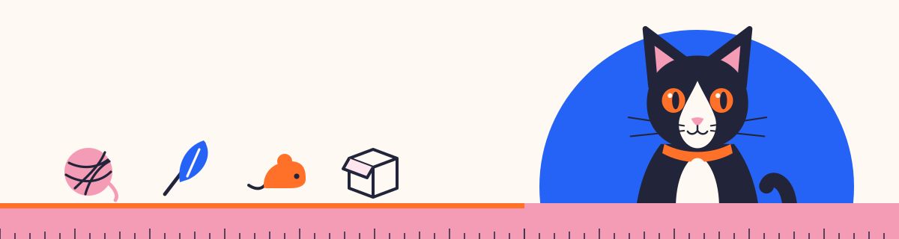

<!--
  DRAFT for the GitHub profile README (repository hienta16/hienta16). Not published.
  To use it: create a public repository named exactly "hienta16", add this README.md and banner.svg, push.
  Shields come from shields.io (an external service), coloured with the site's palette.
-->

### Hi, I'm Hien Ta!

I like finding patterns: in datasets, in playlists, and in the way a cat studies a room before it moves.
Part numbers, part instinct, part style.

- 🐈‍⬛ **Cats** taught me to watch the whole room before I pounce.
- 🎵 **Music** taught me that rhythm is just a pattern you can feel.
- 💃 **Dance** taught me to count to eight, then do it again, better.
- 👗 **Fashion** taught me that the same data tells a new story in every outfit.

**My GitHub, styled:** real stats, a 3D runway of my year, and a cat who chases your cursor →
[hienta16.github.io](https://hienta16.github.io) *(link works once the site is published)*

Leave the cat a toy: open an issue titled `[cat-toy] yarn` on the site's repository.
